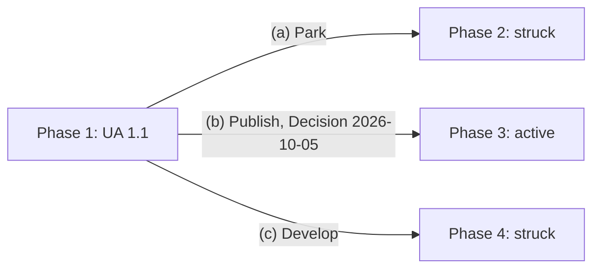

# MASTER_PLAN.md - Space Peak (Satellite Peak)

Planning architect document for the CodeCraft orchestration system. Written 2026-07-14. Plan only; nothing here authorizes building anything. Per the fleet brief, Space Peak is the lowest priority project in the fleet and is not a hero target, so this is deliberately the shortest master plan in the system: one decision, then branches.

## Plan map

| Section | Its steps |
| --- | --- |
| [Terms](MASTER_PLAN_CONTEXT.md#terms), [Mission](MASTER_PLAN_CONTEXT.md#mission), [Current state](MASTER_PLAN_CONTEXT.md#current-state) | |
| [Phase 1: The decision](MASTER_PLAN_PHASES_1_2.md#phase-1-the-decision) | [UA 1.1](MASTER_PLAN_PHASES_1_2.md#ua-11---disposition-decision) |
| [Phase 2: Park](MASTER_PLAN_PHASES_1_2.md#phase-2-park-conditional-only-if-ua-11--park-struck-by-decision-2026-10-05) | PT 2.1 |
| [Phase 3: Publish as thought leadership](MASTER_PLAN_PHASE_3.md#phase-3-publish-as-thought-leadership-conditional-only-if-ua-11--publish) | [PT 3.1](MASTER_PLAN_PHASE_3.md#pt-31---adapt-the-brief-into-a-publishable-draft), [UA 3.2](MASTER_PLAN_PHASE_3.md#ua-32---astraeon-reviews-and-places-the-piece), [PT 3.3](MASTER_PLAN_PHASE_3.md#pt-33---final-pre-ship-review) |
| [Phase 4: Develop the thesis](MASTER_PLAN_PHASE_4.md#phase-4-develop-the-thesis-conditional-only-if-ua-11--develop-struck-by-decision-2026-10-05) | [PT 4.1](MASTER_PLAN_PHASE_4.md#pt-41---ruggedized-satellite-landscape-memo), [PT 4.2](MASTER_PLAN_PHASE_4.md#pt-42---power-and-cadence-model-memo), [PT 4.3](MASTER_PLAN_PHASE_4.md#pt-43---firing-lane-and-land-status-pre-diligence-memo), [UA 4.4](MASTER_PLAN_PHASE_4.md#ua-44---go-pivot-or-park) |
| [Open questions for Astraeon](MASTER_PLAN_PHASES_1_2.md#open-questions-for-astraeon) | |
| [Decisions](#decisions) | Below, in this file |

## Decisions

### Decision 2026-10-05: Publish, standalone (UA 1.1)

Paul chose option (b), **Publish**, under the Space Peak name, standalone rather than under the Photon Mountain umbrella. Phase 3 is active; Phases 2 and 4 are struck, as the Phase 1 exit criteria require. The decision was recorded in `README.md` and `CLAUDE.md` on 2026-10-05; this entry, added 2026-11-12, puts it under the dated heading Phase 1 asks for.

### Decision 2026-11-12: Open source

Paul asked for Space Peak to be an open-source repository, so outside contributors and the Colorado Startups community can contribute. The repository becomes public. On licensing, Paul said the same day: "as lenient as possible for everything... we're not gonna try and enforce it." Content is CC0 1.0; code is CC0 1.0 OR 0BSD.

A public repository is not publication of the thought-leadership piece. UA 3.2 still governs that piece: it is posted, placed or sent only on the owner's action.

### Decision 2026-11-16: spacepeak.co, and the hard lines are gone

Paul bought spacepeak.co. Space Peak's venue is a standalone website there, not one written piece, which settles the venue question in UA 3.2. Paul gives the production go-live.

The same day, Paul removed the repository's hard lines: the Blanca Peak and Crestones exclusions, their frozen register rows and the blocking hook, the ban on deploying, and the rule that a draft adds no facts beyond the brief. New facts are welcome with a register row and a source. Phase 3 now builds the website.

### Decision 2026-11-27: the five odds approved

Paul approved the five estimates on the home page, Q-01 to Q-05, in chat on 2026-11-27. His words were "Approve all five".

Each file in `data/estimates/` now says `approved: true` and `approved_on: 2026-11-27`. The site tags each one "estimate", not "draft estimate". No chance, question, reasoning, date or source changed. Each register row stays `open` until its question resolves.

### Decision 2026-11-28: Live on spacepeak.co

Paul said "go live" on 2026-11-28. spacepeak.co serves the site, and www redirects to it. The preview stays out of search ([#211](https://github.com/Colorado-Startups/space-peak/issues/211)).
