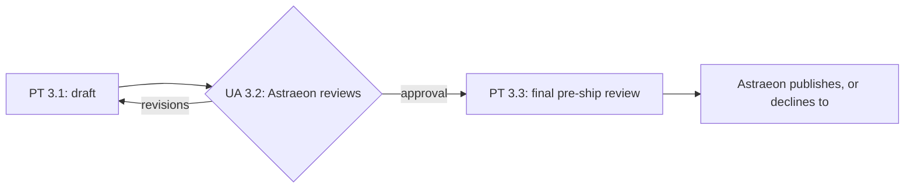

# MASTER_PLAN: Phase 3

Moved whole, word for word, from [MASTER_PLAN.md](MASTER_PLAN.md).

## Phase 3: Publish as thought leadership (conditional, only if UA 1.1 = Publish)

| | |
| --- | --- |
| **Goal:** | Ship the idea as a written piece, with every mountain-specific fact either verified or explicitly labeled speculative, without implying a real venture exists. |
| **Exit criteria:** | A final draft approved by Astraeon exists in this folder, has passed fact and voice review, and Astraeon has published it or explicitly declined to. |

### PT 3.1 - Adapt the brief into a publishable draft

| | |
| --- | --- |
| **Objective:** | Produce DRAFT-thought-leadership.md in this folder from the concept brief, reframed for a public audience, preserving the brief's own speculative labeling. If UA 1.1 chose the Photon Mountain umbrella, conform the draft to the Photon Mountain voice doctrine. |
| **Acceptance checks:** | Draft keeps the "speculative venture thesis, not an engineering proposal" framing verbatim or equivalent; every mountain-specific fact carried over is marked as unverified or removed; no em dashes; no invented facts beyond the brief. |
| **Verification method:** | Side-by-side pass against Satellite-Peak-Concept-Brief.md confirming no new factual claims were introduced; if under Photon Mountain, run the pm-voice-check and pm-fact-guardrails skills and record their results in the PT Review. |

### UA 3.2 - Astraeon reviews and places the piece

| | |
| --- | --- |
| **Objective:** | Astraeon reads the draft, approves or requests revisions, and decides venue and byline (Photon Mountain channel or standalone). |
| **Acceptance checks:** | Written approval or a revision list; venue named; if revisions, PT 3.1 reruns and this UA repeats. |
| **Verification method:** | Approval recorded in this folder or the PT log before anything ships; no publication occurs without it (publishing is an Astraeon-only action per the escalation rules in pt_protocol.md). |

### PT 3.3 - Final pre-ship review

| | |
| --- | --- |
| **Objective:** | Run the full pre-ship gate on the approved draft and hand Astraeon a ship-ready file. |
| **Acceptance checks:** | Facts verified or labeled speculative; voice intact; no em dashes; visuals (the three SVGs and site-map HTML) either included with the same speculative labeling or excluded deliberately. |
| **Verification method:** | PT Review gate per pt_protocol.md, checklist ticked item by item; a fact-check sweep on the final file with results logged. |
