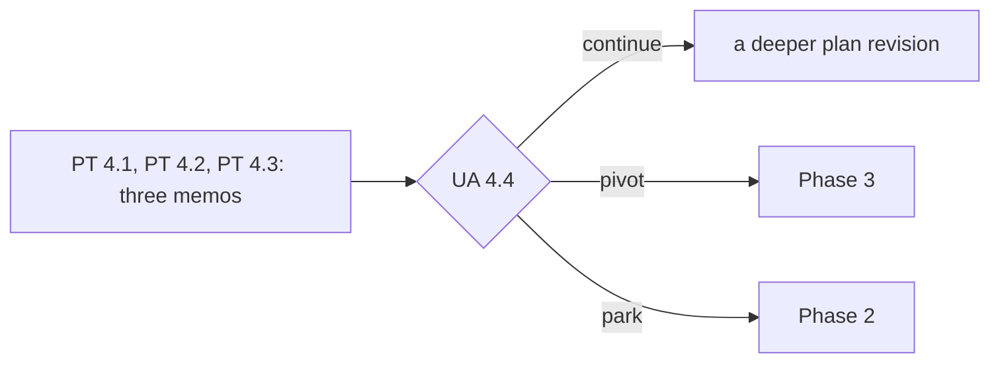

# MASTER_PLAN: Phase 4

Moved whole, word for word, from [MASTER_PLAN.md](MASTER_PLAN.md). In this section, "this file" means the whole plan.

## Phase 4: Develop the thesis (conditional, only if UA 1.1 = Develop). Struck by Decision 2026-10-05

| | |
| --- | --- |
| **Goal:** | Convert the brief's four make-or-break items into researched memos with real sources, ending in an informed continue-or-park decision. Research and writing only; no engineering, no land contact, no filings. |
| **Exit criteria:** | Three diligence memos exist in this folder with cited sources, and UA 4.4 records a go, pivot, or park decision. |

### PT 4.1 - Ruggedized-satellite landscape memo

| | |
| --- | --- |
| **Objective:** | Research and write MEMO-1-ruggedized-satellites.md: the state of high-g-tolerant satellite hardware and who is working on it. The brief calls this the actual moat; test that claim against published sources. |
| **Acceptance checks:** | Every claim cited to a source found during research; the brief's ~200 g survivability figure treated as a hypothesis to check, not a fact; memo ends with an explicit "supports / weakens the thesis" judgment. |
| **Verification method:** | PT Review gate: spot-check citations resolve; confirm no uncited engineering numbers. |

### PT 4.2 - Power and cadence model memo

| | |
| --- | --- |
| **Objective:** | Research and write MEMO-2-power-cadence.md: what grid feed and storage a gigawatt-scale pulsed launcher would actually require, and whether the brief's once-an-hour cadence claim survives contact with published numbers. |
| **Acceptance checks:** | All energy and cadence figures sourced or derived with the derivation shown; the brief's cadence claim explicitly tested; memo states its confidence level. |
| **Verification method:** | PT Review gate: rerun any arithmetic in the memo independently and confirm it matches before passing. |

### PT 4.3 - Firing-lane and land-status pre-diligence memo

| | |
| --- | --- |
| **Objective:** | Research and write MEMO-3-sites-and-lanes.md covering the brief's top two candidates only, Greenhorn (DoD Piñon Canyon corridor) and Culebra (single private owner), from public sources. Desk research only; no outreach to any landowner, agency, or the Army. |
| **Acceptance checks:** | Every land-status, ownership, and corridor claim in the brief's site table is confirmed, corrected, or marked unverifiable from public sources; no contact with any third party occurred. |
| **Verification method:** | PT Review gate: diff the memo's findings against the brief's site table row by row and log which cells changed. |

### UA 4.4 - Go, pivot, or park

| | |
| --- | --- |
| **Objective:** | Astraeon reads the three memos and decides: continue toward a deeper plan revision, pivot to Phase 3 (publish what was learned), or park via Phase 2. |
| **Acceptance checks:** | A dated decision appended to this file; if continue, Astraeon names what the next plan revision must cover. |
| **Verification method:** | Orchestrator confirms the decision entry and activates the corresponding branch or drafts the plan revision for approval. |
