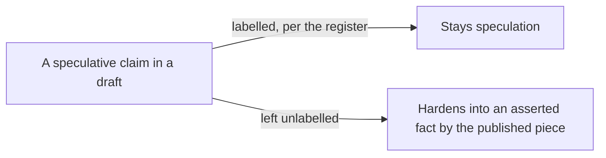

# Voice: the rules that need judgement

Part of the [Space Peak voice](voice.md). This is the judgement half, and step 5 of the `space-peak-publish-gate` skill carries it too.

## Speculation is labelled, not implied

The concept brief's subtitle does the work in one line. It is a speculative venture thesis, not an engineering proposal. Every fact about a specific mountain is a starting point for real diligence, not a verified site assessment.

Carry that framing into every piece. The claims register's [labelling rule](../02_substance/claims_register.md#labelling-an-unconfirmed-figure) says how a piece labels each claim, in Markdown and on the site.

This is the rule `04_tools/space_peak_claims.py` and `02_substance/claims_register.md` exist to protect. Speculation left unlabelled does not stay speculation. It hardens into an asserted fact somewhere between a draft and a published piece, and nobody can point at the moment it happened.

## Honest about the timeline

The physics is sound. The engineering is 2040s-hard. Both halves ship together, every time. A piece carrying the first without the second is marketing, and this project has nothing to market yet.

## Write for a reader who will check

Assume someone reads this who knows more about mass drivers, Colorado land status, or FAA regulation than we do. That reader is the audience, not an adversary. It means no rounded-up numbers, no borrowed confidence, and no claim that would embarrass us if a specialist followed the citation.

## Two failure modes no lint can catch

From the house rules, and worth repeating because this project is unusually exposed to both. Check both by hand before anything ships.

| Failure mode | Example |
| --- | --- |
| A hedged source set as an exact number in display type | The brief's "about 200 g" becoming "200 g" in a pull quote |
| A status verb drifting under compression | "The brief proposes" becoming "the plan is" |
