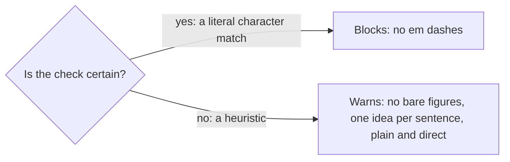

# Voice: the rules a machine enforces

Part of the [Space Peak voice](voice.md), which states the precedence. The mechanical half is `04_tools/space_peak_lint.py`, ported from `Photon Mountain/04_tools/voice_lint.py`.

Severity for every rule below comes from `04_tools/space_peak_rules.json`, never from the script. The split follows the house rule: **block on the certain, warn on the likely.** Blocking on a heuristic teaches people to bypass the gate, which costs more than it saves.

## Blocking: no em dashes, anywhere

Not in drafts, not in memos, not in commit messages, not in this doctrine. Use a comma, a semicolon, a period, or parentheses. Four marks cover every job an em dash does, and each tells the reader more about the relationship between the clauses. A spaced en dash reads as an em dash, so that is out too.

Both checks block: `em-dash` and `spaced-en-dash`. Each is a literal character match, so each is deterministic, fast, and auto-fixable without judgement. No other purely stylistic rule gets that treatment.

History: the original concept brief was written with 35 em dashes, before this rule existed. The repository's first commit preserves it exactly as written, and a later commit normalizes it. The history shows the project as it actually was, which matters more than a clean first commit.

## Warning: no bare figures

Every number presented as a fact needs one of three things in the same sentence:

| One of | What it looks like |
| --- | --- |
| **An attribution** | Who says so, and where a reader can check |
| **A goal label** | "Reaching one launch an hour is a goal" is honest. "The cadence is one launch an hour" is not, yet |
| **A speculative label** | "On the order of 200 g, unverified" is honest. "200 g" alone is a claim this project has not earned. The register's [labelling rule](../02_substance/claims_register.md#labelling-an-unconfirmed-figure) gives each form |

This **warns** and does not block, which is a deliberate change from the upstream Photon Mountain script. That script graded it a failure while its own docstring called the check a heuristic that flags candidates for human review. A gate cannot both call itself a heuristic and block on itself.

## Warning: one idea per sentence

Flagged at 30 words, which is a proxy, not the rule. The real rule is meaning. If a reader has to hold two things at once to reach the period, split it. A 34-word sentence carrying one idea is fine. A 22-word sentence carrying three is not, and the linter will not catch it. That is what the [judgement pass](voice-judgement.md) is for.

## Warning: plain and direct

Hedge words and AI tells warn under one check. [Plain words](voice-plain-words.md) lists them, with the one documented divergence.
