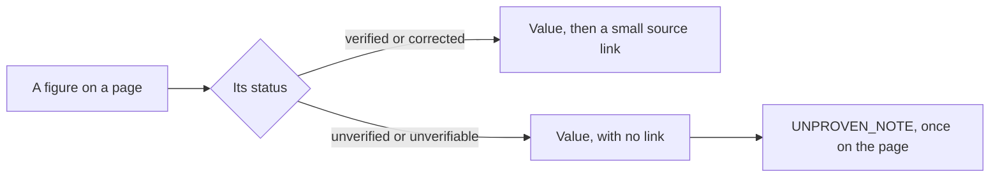

# Voice: the map and the site

Part of the [Space Peak voice](voice.md).

## Visual voice on the map

Set 2026-11-15 with the first map, `03_deliverables/map/`. A symbol is an argument, so each layer gets its own. Paul set the site's labels on 2026-11-28 (issue #153), and the table follows the site's `/map/`.

| Thing | Symbol | Label |
| --- | --- | --- |
| A summit on the tour | An open triangle | Its name. The page says "speculative" once, above the map. The list beside the drawing gives its role: Summit, or Name and headquarters for Pikes Peak |
| The Colorado Startups region loop | A road-drawn outline with a light fill | Whose definition it is: the website's region, not a launch complex |

## Figures on the site

Set by Paul on 2026-11-28 (issue #153). This is the site's form of the label rule: [no bare figures](voice-machine-rules.md#warning-no-bare-figures), and [speculation is labelled](voice-judgement.md#speculation-is-labelled-not-implied).

| Figure | What the page shows |
| --- | --- |
| Sourced and confirmed (`verified`, `corrected`) | Its value, then a small "source" link |
| Unconfirmed (`unverified`, `unverifiable`) | Its value, with no link |
| Any page with an unconfirmed figure | One line, once: `UNPROVEN_NOTE` in `site/src/components/figure.ts` |

No status chip, claim ID or read date shows on a page. The register and `/data/claims.json` keep them. Prose in the piece still labels each claim where it stands.
