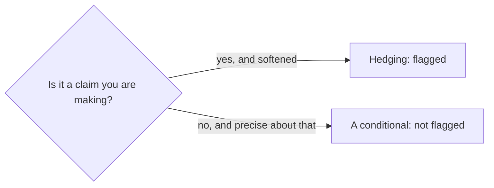

# Voice: plain words

Part of the [Space Peak voice](voice.md), and the last warning in the [machine rules](voice-machine-rules.md). It quotes the terms it flags, so it has an entry, with its reason, in `exempt_paths` in `04_tools/space_peak_rules.json`.

## Warning: plain and direct

Hedging words are flagged, and the AI tells from the house rules file are flagged under the same check. Say it plainly or cut it.

| Flagged | Terms | In the rules file |
| --- | --- | --- |
| Hedging words | arguably, perhaps, somewhat, potentially, seemingly, essentially, basically, virtually | `hedge_words`, the full list |
| AI tells | delve, tapestry, plethora, seamless, game-changer, a testament to, it's important to note, navigating the complexities, in conclusion | `ai_tells` |
| Not flagged: conditionals | "could be", "might be", "may be" | `hedge_words.deliberately_absent` |

## One documented divergence

The Photon Mountain doctrine also treats "could be", "might be", and "may be" as hedges. This project does not. Space Peak is a speculative thesis about technology that does not exist yet, and conditional language is the honest register for it. Flagging conditionals would train the writer out of exactly the qualifications the thesis depends on.

The distinction: hedging is softening a claim you are making. A conditional is being precise about a claim you are not making.

This divergence is registered in the rules file under `hedge_words.deliberately_absent`, with its reason. The contract test asserted that `voice.md` explains it (C12b) until #32 dropped the prose agreement checks; no test reads this prose now. It covers only those three terms. "Potentially" is banned, because the house rules name it ([the correction](voice.md#precedence-stated-before-anything-else)).
