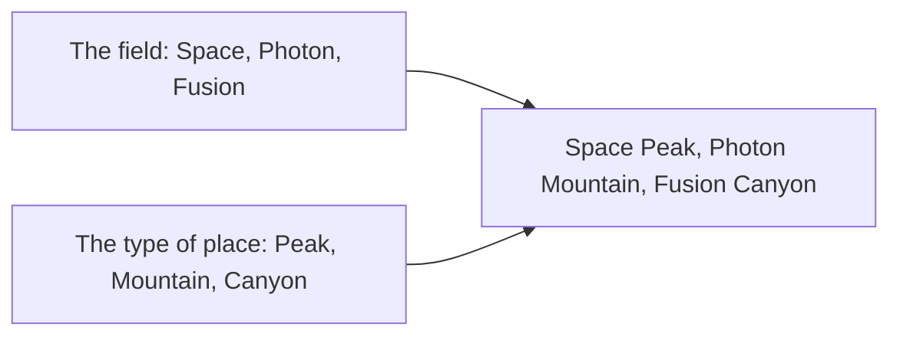

# Voice: terminology and lineage

Part of the [Space Peak voice](voice.md).

## The project is Space Peak

Decided 2026-10-08. Not "Satellite Peak", which the concept brief argued for in its first draft. Register row N-04, issue #2, Route 2.

Use **Space Peak** everywhere: the project, the repository, the tooling namespace, the venture, and the piece. There is no second name and no split between a project name and a venture name.

Why, for anyone tempted to reopen it:

| Reason | Detail |
| --- | --- |
| The field, not the product | The naming formula is *the field plus the type of place*, not *the product plus the type of place*. A satellite is a product. Space is the field, and the corridor does launch, ground systems and space science as well as satellites |
| The siblings | They name fields too: Photon Mountain, Fusion Canyon. "Satellite Peak" would have been the one product name in a family of fields |
| One name | A place brand works when there is one name to remember. Two names for one initiative split recall and need explaining every time either appears |

The brief's naming section now makes this case directly, and lists "Satellite" among the rejected alternatives beside "Aero" and "Radar". `00_project_system/MASTER_PLAN.md` still carries the old name in places; it is a frozen planning record from 2026-07-14 and is left as written.

This was decided by the cross-session orchestrator on Paul's delegation. Paul can reverse it, and the pull request that landed it is the place to say so.

## Lineage

Space Peak, Photon Mountain, and Fusion Canyon are driven by Colorado Startups and supported by Colorado AI. Space Peak ships under its own name, not the Photon Mountain brand. There was no reason to invent a voice from scratch when a working one exists next door. So this doctrine starts as Photon Mountain's, and will earn its differences, not assert them.
