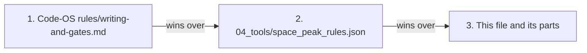

# Space Peak Voice

*Created 2026-10-05. Derived from the Photon Mountain voice doctrine, which this project mirrors for now and will diverge from over time.*

This file is the entry point. It states the precedence, then links each part of the doctrine.

## Precedence, stated before anything else

This doctrine restates rules that live elsewhere. Where it does, the higher layer wins.

| Layer | Role |
| --- | --- |
| 1. Code-OS `rules/writing-and-gates.md` | Canonical, and wins. It is the maintainer's house writing standard (not public) |
| 2. `04_tools/space_peak_rules.json` | The machine-readable copy that the checkers read. It carries every house rule that applies here, so this repository is complete for contributors. It must agree with the house file, and loses to it |
| 3. This file and its parts | The project prose layer. If it and the JSON disagree, the JSON wins |

**The remedy, not just the precedence:** when a disagreement is found, the losing file is corrected in the same session. Precedence without a remedy becomes a standing excuse for drift.

One correction has already run through that path. An earlier draft of this file argued that conditionals are honest framing for technology that does not exist yet. It un-flagged "potentially" along with "could", "might" and "may". The house rules name **"potentially"** in the hedging cut list. The house file won: "potentially" is now banned here too. The divergence covers only the three terms the house rules do not name: "could be", "might be" and "may be" ([Plain words](voice-plain-words.md#one-documented-divergence)).

## The parts

| Part | What it covers |
| --- | --- |
| [Machine rules](voice-machine-rules.md) | Block on the certain, warn on the likely. No em dashes, no bare figures, one idea per sentence |
| [Plain words](voice-plain-words.md) | Hedge words, AI tells, and the one documented divergence |
| [Judgement rules](voice-judgement.md) | Labelled speculation, the timeline, the reader who will check, and two failure modes no lint can catch |
| [Terminology and lineage](voice-terminology.md) | The project is Space Peak, and where this voice comes from |
| [Map and site](voice-map-and-site.md) | Visual voice on the map, and figures on the site |

## What this doctrine does not cover yet

Deliberate gaps, to be filled when there is something real to say, not filled now for completeness:

- Tone in long-form versus short-form. There is one draft; there is no evidence yet.
- Visual voice for the SVGs. The map has its convention, in [Map and site](voice-map-and-site.md); the three SVGs predate it.
