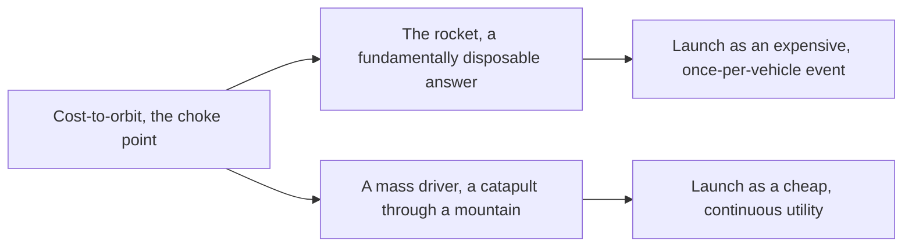

# Space Peak

## A concept brief for a Colorado mass-driver launch complex

*Draft v1, July 2026. A speculative venture thesis, not an engineering proposal. Physics is sound; timelines are 2040s-hard; every "fact" about a specific mountain is a starting point for real diligence, not a verified site assessment.*

## The one-line pitch

The choke point in the entire space economy is cost-to-orbit. The rocket is a fundamentally *disposable* answer to it. A ground-based electromagnetic mass driver (a catapult through a mountain) turns launch from an expensive, once-per-vehicle **event** into a cheap, continuous **utility**. Space Peak is that utility, sited at the foot of Colorado's existing aerospace corridor, which already builds, flies, and defends the things it would launch.

Silicon Valley won because fabs could stamp out chips continuously and cheaply. Space Peak wins the same way, not because it *can* launch, but because it could launch *constantly*. The mountain isn't a launchpad. It's a turnstile.

## Why this, why now

| Shift | The case |
| --- | --- |
| Infrastructure | Satellites went from Cold War prestige to load-bearing infrastructure. GPS is really a **clock** system underpinning finance, telecom, and the power grid. Its loss costs ~$1B/day per country. Weather, Earth observation, and connectivity have no good ground substitute over ocean, ice, battlefield, or atmosphere |
| Demand | The emerging demand curve is even steeper: mass-produced satellites (Starlink-class) and direct-to-cell. **Orbital data centers / "cloudstations"** could join them. Cloudstation nodes only pencil out if getting mass to orbit is a factory line, not a national event |
| Reuse | Reusable rockets (Falcon-class) already cut $/kg tenfold, but a landed booster is still a whole vehicle rebuilt per flight. The next order-of-magnitude gain comes from moving the energy source *off* the vehicle. Rockets aren't archaic because of the fire; they're archaic because they're **off-grid**. The future of launch is plugging it in |

## The core insight

Every credible non-rocket launch method replaces *"carry your energy"* with *"receive your energy"*, delivered by beam, tether, or track. Ranked by arrival:

| # | Method | Arrives | Note |
| --- | --- | --- | --- |
| 1 | **Reusable rockets** | Now | Aesthetically archaic, economically the cheapest kg-to-orbit in history |
| 2 | **Kinetic launch** (mass driver / sling) | 2030s to 2040s, cargo only | The Space Peak bet |
| 3 | **Serviced-not-disposed satellites** | Starting now | Gecko-gripper tugs extend life; recycling shrinks how much you launch at all |
| 4 | **Orbital manufacturing from space materials** | Endgame | "Launching satellites" becomes a phrase like "dialing a phone" |

## Read on

| Part | Covers |
| --- | --- |
| [1. Why a mountain](brief/1-why-a-mountain.md) | Cargo only, cadence, make or break |
| [2. Site tour](brief/2-site-tour.md) | Colorado candidates, honest ranking, the Cape/Houston split |
| [3. The name](brief/3-the-name.md) | Why "Space Peak"; the nature footnote |
| [4. Risks and next steps](brief/4-risks-and-next-steps.md) | Honest risk register, suggested next steps |
