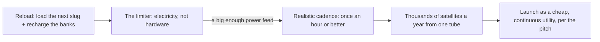

# Part 1: why a mountain

From the [Space Peak concept brief](../Space-Peak-Concept-Brief.md), a speculative venture thesis, not an engineering proposal.

## Why a mountain, and why cargo-only

| Point | The case |
| --- | --- |
| **Speed, not height**. | Low orbit is about 17,500 mph *sideways*, not an altitude ([NASA](https://www.nasa.gov/learning-resources/for-kids-and-students/what-is-microgravity-grades-5-8/), read 2026-11-16). The catapult supplies velocity; a small onboard thruster circularizes at apogee |
| **Altitude is a spec, not scenery**. | Exiting at 12,000 to 14,000 ft leaves about 36 to 41% of the atmosphere's mass below the muzzle ([NASA Glenn's atmosphere model](https://www.grc.nasa.gov/www/k-12/airplane/atmos.html), read 2026-11-16). That is the difference between "survivable with an ablative shell" and "meteor in reverse." Granite peaks let you bore the acceleration tunnel through solid rock |
| **A ~200 g design target over a ~10-mile run**. | It reaches ~8 km/s, per the arithmetic in claims register P-03. Humans tap out around 10 g (unverified). Hardened satellites can take far more: guided artillery survives 15,000 g (unverified). **This is a cargo-only technology forever.** People always ride something gentler |
| **The "fuel" is electricity**. | Charge capacitor/flywheel banks between shots, release a gigawatt-scale pulse in seconds. Nothing staged, nothing dropped. One hardened slug per shot, kept whole to orbit (integral electric thruster like Starlink; ablative or retained aeroshell so even the skin sheds only gas) |

## Cadence, the killer feature

| | Rocket | Mass driver |
| --- | --- | --- |
| What it is | A *building* you fuel and destroy once | A *machine* you cycle |
| Reload | Build a new rocket (days to weeks) | Load the next slug + recharge the banks |
| Its image | Artillery, one shell at a time | The sling is a freight conveyor. Load, charge, fire, repeat |

The limiter is **electricity, not hardware**. With a big enough power feed, realistic cadence is **once an hour or better, thousands of satellites a year from one tube**. That compares with ~250 rocket launches worldwide in a busy year (unverified). Secondary limiters (re-pump tunnel vacuum, cool the rails, inspect) are pit-stop jobs, not day-long ones.

## What actually makes or breaks a company here

The mountain is the romantic part. The business lives or dies on:

1. **Satellites redesigned to survive the ~200 g design target**. A ruggedized-satellite factory is the real moat.
2. **The vacuum muzzle**, a membrane or plasma window that holds vacuum while passing a Mach-23 slug.
3. **Reliability record**. "Nines" demonstrated by no one so far; this is the key that unlocks overland launch.
4. **The FAA relationship + a cleared firing lane**, a political achievement as much as an engineering one.

Next: [part 2, site tour](2-site-tour.md).
