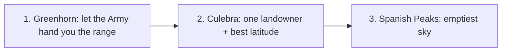

# Part 2: site tour

From the [Space Peak concept brief](../Space-Peak-Concept-Brief.md), a speculative venture thesis, not an engineering proposal.

## Site tour, Colorado candidates

Selection criteria, in priority order: **southern latitude** (more free spin from Earth's rotation), **clean east/southeast firing lane over empty land**, **good granite**, **road/rail access**, **fewest stakeholders**.

*Every elevation, land status, ownership and firing-lane claim in this table is unverified (claims register S-01 to S-21). The exceptions are the Pikes Peak landmark (S-16), the Crestones land status (S-18) and Blanca's sacred status (S-20). Culebra has three: its elevation (S-04, corrected), its place as Colorado's southernmost 14er (S-05, corrected) and its single private owner (S-06).*

| Site | Elev (ft) | Why it's interesting | The veto |
|---|---|---|---|
| **Greenhorn / Wet Mtns** | ~12,300 (unverified) | Fires east straight over **Piñon Canyon** Army live-fire land. DoD already keeps the corridor empty & controlled. **Engineering winner.** | Lower altitude; still federal land |
| **Culebra Peak** | 14,053 (per S-04) | **Colorado's southernmost 14er** (~37.1°N, best spin); **privately owned** (Cielo Vista Ranch) = one landowner, not the USFS | Private-deal complexity; watershed |
| **Spanish Peaks** | ~13,600 (unverified) | Standalone cones; **emptiest sky**, open SE shot over Comanche National Grassland; less mountain to bore | Federal land; lower |
| **Almagre ("Baldy")** | 12,367 (unverified) | Same granite batholith as Pikes, workforce next door, existing towers/road. SE lane over Fort Carson ranges | USFS; city watershed on its flanks |
| **Pikes Peak** | 14,115 (unverified) | The **brand** + workforce + road & cog rail | 39°N, fires east over Kansas/metro; Nat'l Historic Landmark; donut shop |
| **Crestones / Sand Dunes** | ~14,000 (unverified) | South, high, empty east lane; grippy Crestone conglomerate | National Park, and the wilderness beside it |
| **Blanca Peak** | 14,345 (unverified) | High and south, on paper near-perfect | Sisnaajiní, sacred to the Navajo |

**Honest ranking for a real attempt**, best first:

Pikes and Almagre are the sentimental favorites, not the optimal ones.

**The Cape/Houston split:** the best *engineering* site and the best *name* need not be the same mountain. Cape Canaveral launches; "Houston" is what the astronauts say. **Tunnel through Greenhorn; headquarter on Pikes.** The anonymous mountain does the work; the famous one takes the calls.

Next: [part 3, the name](3-the-name.md).
