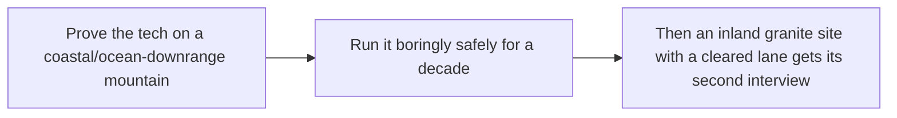

# Part 4: risks and next steps

From the [Space Peak concept brief](../Space-Peak-Concept-Brief.md), a speculative venture thesis, not an engineering proposal.

## Honest risk register

| Risk | The brief's read |
| --- | --- |
| **Timeline** | Physics is sound; engineering is 2040s-hard. This is a long-horizon bet wearing a near-term costume |
| **Muzzle seal and survivability** | **The muzzle vacuum seal** and **satellite survivability at the ~200 g design target** are unsolved at production scale |
| **Overland launch** | Overland launch from an inland US site has FAA backing for suborbital flight, as at Spaceport America in 2008 (register E-04, corrected). Orbital launch inland is unchecked, and is earned only by a long clean reliability record. A mass-driver failure is *not* a rocket explosion (no fuel, no staged debris). At most it is an ablative shell + a dense slug on a predictable arc, if the circularization motor fails. That puts it closer to aviation's risk profile than artillery's. That's the argument that eventually opens overland launch, but it must be *demonstrated*, not asserted |
| **Sonic boom corridor** | A sonic boom corridor over any populated area is a civic fight (the city-council problem) |
| **Land status** | Land status is destiny: National Park = never; sacred peak = never; national forest = brutal; Army range or single private owner = tractable |
| **Realistic path** | Prove the tech on a coastal/ocean-downrange mountain (Mauna Kea, Chimborazo-class), and run it boringly safely for a decade. *Then* an inland granite site with a cleared lane gets its second interview |

## Suggested next steps (if we're serious)

1. Nail the **ruggedized-satellite** reference design (the actual moat) before the mountain.
2. Model the **power system**, grid feed + storage that sets the true cadence.
3. Pre-diligence the **firing-lane politics** for Greenhorn (DoD) and Culebra (private owner).
4. Keep **Pikes/Space Peak** as the brand + HQ + workforce story.

*From "what's Colorado Springs known for" to a launch-complex thesis in one sitting. The mountain is ready. The century isn't. Yet.*
