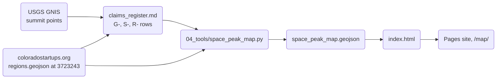

# Map

The Space Peak map: one MapLibre page over OpenFreeMap with Mapterhorn hillshade, built 2026-11-15. It is a repository deliverable, and the starting point for the spacepeak.co map.



## Files

| File | Holds | Made by |
| --- | --- | --- |
| `index.html` | The page: two toggled layers, a facts panel for the loop, and the site lists that are its accessible alternative | Hand |
| `space_peak_map.geojson` | Every feature the page draws, with the register revision it came from | `04_tools/space_peak_map.py`. Never edit by hand |
| `README.md` | This file | Hand |

## The two layers

| Layer | Symbol | Carries | Register rows |
| --- | --- | --- | --- |
| Region loop | Glow, casing and line over a fill | Roads, cities, area, span and size, each sourced | R-01 to R-05 |
| Summits in the brief | Blue dot, labelled "speculative" | GNIS point and ID; each brief claim and its status | G-01 to G-07 and their `S-` rows |

The summits are in register order, which is not a ranking.

The region loop is the website's, not this project's. On coloradostartups.org, "Space Peak" is also the name of the Colorado Startups region for Colorado Springs and Fountain. It is a loop of major roads, and it says nothing about where a mass driver would go.

## Where each point comes from

| Point | Source | Kept off the map |
| --- | --- | --- |
| Seven summits in the brief | USGS GNIS, one feature ID each, register G-01 to G-07 | None. Every site in the brief has a GNIS summit |

The brief names the Spanish Peaks as a pair. The map pins West Spanish Peak and records East Spanish Peak's feature ID in the register (G-03). It pins Crestone Peak for the Crestones and Great Sand Dunes (G-07).

## Rebuild the data

The script reads the register and the website's region file. It writes the GeoJSON and records the register's git blob and the date in `generated`. So rerun it after any register edit: `ci.yml` runs `--check`, which fails while the GeoJSON is stale. `--region-url` prints the region file's URL at the commit the R- rows cite, so that pin lives only in the script.

```bash
curl -fsSL "$(python3 04_tools/space_peak_map.py --region-url)" -o /tmp/regions.geojson
python3 04_tools/space_peak_map.py --region-geojson /tmp/regions.geojson
python3 04_tools/space_peak_map.py --region-geojson /tmp/regions.geojson --check
```

The committed file was generated on 2026-11-16 from register blob `ba87e01c657d2148ea3b80a49240ca0d7e43478b`, which `git hash-object 02_substance/claims_register.md` reproduces. A new coordinate needs a `G-` row with its source first; the script reads nothing else.

## Look at it locally

```bash
cd 03_deliverables/map && python3 -m http.server 3316 --bind 127.0.0.1
```

Then open `http://localhost:3316/`. A `file://` page cannot fetch the GeoJSON.

## Credits

Summit points: USGS GNIS, public domain. Region loop: US Census TIGERweb road lines, via the coloradostartups.org repository; Census data is not copyrighted. The data here is CC0. The basemap tiles load at view time from OpenFreeMap (OpenMapTiles, OpenStreetMap contributors) and the terrain from Mapterhorn, and the map displays their credit. No OpenStreetMap data is stored in this repository.

## History

| Date | Change |
| --- | --- |
| 2026-10-05 | Felt was the plan; its MCP was not on the workspace plan, and no register row held a coordinate |
| 2026-11-15 | This page replaces an earlier Leaflet site map whose coordinates had no register rows and which drew the exclusions in the same symbol as the summits |

## The three SVGs

`03_deliverables/infographics/` holds three hand-drawn SVGs that predate this map. Each is now superseded, kept because it does a different job, or retired. The mass-driver cross-section is a diagram rather than a map and probably survives. That is a recommendation, not a decision.
