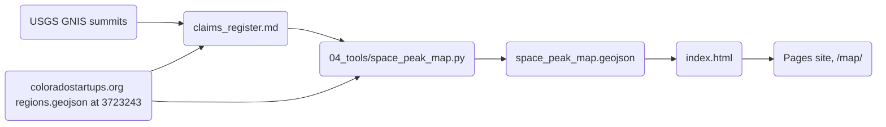

# Map

The Space Peak map: one MapLibre page over OpenFreeMap with Mapterhorn hillshade, a repository deliverable and the spacepeak.co map's starting point.



## Files

| File | Holds | Made by |
| --- | --- | --- |
| `index.html` | The page: two toggled layers, a facts panel for the loop, and site lists as its accessible alternative | Hand |
| `space_peak_map.geojson` | Every feature the page draws | `04_tools/space_peak_map.py`. Never edit by hand |
| `README.md` | This file | Hand |

## Layers

| Layer | Symbol | Carries | Register rows |
| --- | --- | --- | --- |
| Region loop | Glow, casing and line over a fill | Roads, cities, area, span and size, each sourced | R-01 to R-05 |
| The brief's seven summits | Blue dot, labelled "speculative" | GNIS point and feature ID; each brief claim and its status | G-01 to G-07 and their `S-` rows |

Summits follow register order, not a ranking. Every site in the brief has a GNIS summit, so the map omits none.

| Brief site | Pinned | Register |
| --- | --- | --- |
| The Spanish Peaks, a pair | West Spanish Peak; East Spanish Peak's feature ID is recorded | G-03 |
| The Crestones and Great Sand Dunes | Crestone Peak | G-07 |

The loop is the website's, not this project's: coloradostartups.org's Colorado Startups region for Colorado Springs and Fountain, also named "Space Peak". A loop of major roads, it says nothing about where a mass driver would go.

## Rebuild

The script records the register's git blob and date in `generated`. So rerun it after any register edit: `ci.yml` runs `--check`, which fails while the GeoJSON is stale. `--region-url` prints the region file's URL at the commit the R- rows cite, keeping that pin only in the script.

```bash
curl -fsSL "$(python3 04_tools/space_peak_map.py --region-url)" -o /tmp/regions.geojson
python3 04_tools/space_peak_map.py --region-geojson /tmp/regions.geojson
python3 04_tools/space_peak_map.py --region-geojson /tmp/regions.geojson --check
```

Its `generated` field names the register blob and date; `git hash-object 02_substance/claims_register.md` reproduces the blob. A new coordinate needs a `G-` row with its source first; the script reads nothing else.

## Local view

```bash
cd 03_deliverables/map && python3 -m http.server 3316 --bind 127.0.0.1
```

Open `http://localhost:3316/`. A `file://` page cannot fetch the GeoJSON.

## Credits

Summit points: USGS GNIS, public domain. Region loop: US Census TIGERweb road lines, via the coloradostartups.org repository; Census data is not copyrighted. OpenFreeMap's basemap tiles (OpenMapTiles, OpenStreetMap contributors) and Mapterhorn's terrain load at view time, credited on the map. The data here is CC0. This repository stores no OpenStreetMap data.

## History

| Date | Change |
| --- | --- |
| 2026-10-05 | Felt was the plan; its MCP was not on the workspace plan, and no register row held a coordinate |
| 2026-11-15 | This page replaced an earlier Leaflet site map whose coordinates had no register rows and whose exclusions shared the summits' symbol |

## SVGs

`03_deliverables/infographics/` holds three hand-drawn SVGs older than this map, each now superseded, kept for a different job, or retired. The mass-driver cross-section, a diagram and not a map, probably survives: a recommendation, not a decision.
