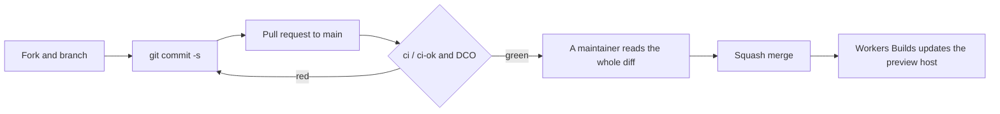

# Contributing

Space Peak is open to everyone. Corrections, sources, drafts, tooling fixes and good questions all count. You do not need to be an engineer to help.

Mountain facts live in `02_substance/claims_register.md`, each with its status.

## Ways to help

| You have | Start here |
| --- | --- |
| A question or an idea | [Discussions](https://github.com/Colorado-Startups/space-peak/discussions), in Q&A or Ideas |
| A claim that is wrong, or a source that verifies one | The **Claim correction** issue form |
| An organisation for spacepeak.co | The **Add your organisation** issue form, or a YAML file in `data/orgs/` |
| Feedback on a draft | The **Draft feedback** issue form |
| A page that is hard to see, hear, read or use | The **Accessibility problem** issue form |
| A page or an MCP tool that is broken | The **Site or MCP problem** issue template |
| A checker that misfired | The **Tooling** issue form |
| A change ready to go | A pull request, below |
| A security concern | `SECURITY.md`. Never a public issue |

Issues labelled `good first issue` are a good place to start.

## Making a pull request

1. Fork the repository and clone your fork.
2. Create a branch, write, and commit with a sign-off: `git commit -s`.
3. Push to your fork and open a pull request against `main`. Fill in the template, including the claims checklist.
4. Read the checks, and fix anything red.

| For | Read |
| --- | --- |
| The sign-off, your contribution's licensing, help from an AI agent, and reviewing outside pull requests | [docs/PULL-REQUESTS.md](docs/PULL-REQUESTS.md) |
| What blocks, what warns, and running the checks yourself | [docs/CHECKS.md](docs/CHECKS.md), [docs/RUNNING-CHECKS.md](docs/RUNNING-CHECKS.md) |
| A check that is wrong, two things no check can catch, and changing a rule | [docs/RULES.md](docs/RULES.md) |

### Sources and read dates

| Rule | Checked by |
| --- | --- |
| Every source is an `https` URL with its publisher | `site/src/lib/orgs/schema.ts` |
| `read` is the ISO date you read it, never a future one | The same schema |
| A quote is 15 words or fewer | The same schema |
| Each fact and location names its source by `id` | The same schema |
| A mountain claim goes in the claims register with its status | `04_tools/space_peak_claims.py` |
| Prose cites as "(Publisher, read 2026-11-16)" | A reviewer, by hand |

## What the checks do

Two checks must pass before a pull request can merge: `ci / ci-ok` and `DCO`. The `DCO` check fails on a commit without a `Signed-off-by:` line.

## Who decides

Paul (`@paul-co-startups`), founder of Colorado Startups, sets the product and the vision. The maintainers review and merge. A pull request merges when the required checks pass and a maintainer has read the whole diff. Disagreement goes to a Discussion, and Paul makes the final call on product and vision.
