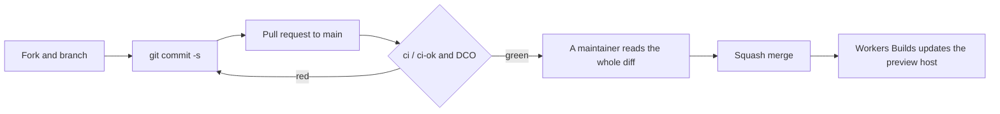

# Contributing



Space Peak is open to everyone. Corrections, sources, drafts, tooling fixes and good questions all count. You do not need to be an engineer to help.

Mountain facts live in `02_substance/claims_register.md`, each with its status.

## Ways to help

| You have | Start here |
| --- | --- |
| A question or an idea | [Discussions](https://github.com/Colorado-Startups/space-peak/discussions), in Q&A or Ideas |
| A claim that is wrong, or a source that verifies one | The **Claim correction** issue form |
| An organisation for spacepeak.co | The **Add your organisation** issue form, or a YAML file in `data/orgs/` |
| Feedback on a draft | The **Draft feedback** issue form |
| A page that is hard to see, hear, read or use | The **Accessibility problem** issue form |
| A checker that misfired | The **Tooling** issue form |
| A change ready to go | A pull request, below |
| A security concern | `SECURITY.md`. Never a public issue |

Issues labelled `good first issue` are a good place to start.

## Making a pull request

1. Fork the repository and clone your fork.
2. Create a branch, write, and commit with a sign-off: `git commit -s`.
3. Push to your fork and open a pull request against `main`. Fill in the template, including the claims checklist.
4. Read the checks, and fix anything red.

### Sign-off (DCO)

Every commit needs a `Signed-off-by:` line, which `git commit -s` adds. It certifies the [Developer Certificate of Origin](https://developercertificate.org/): you wrote the change, or you have the right to submit it. The `DCO` check fails without it.

Fix a missed sign-off with `git commit --amend -s`, or `git rebase --signoff main` for several commits, then push again. Commits that GitHub verifies as coming from `Colorado-Startups` org members skip the check (`.github/dco.yml`).

### Licensing of your contribution

Space Peak is dedicated to the public domain under CC0 1.0, and its code is also offered under 0BSD. See the README's "License" section. Your contribution comes in under the same terms. Do not submit material you cannot release that way, such as someone else's copyrighted text, images or data.

### Sources and read dates

| Rule | Checked by |
| --- | --- |
| Every source is an `https` URL with its publisher | `site/src/lib/orgs/schema.ts` |
| `read` is the ISO date you read it, never a future one | The same schema |
| A quote is 15 words or fewer | The same schema |
| Each fact and location names its source by `id` | The same schema |
| A mountain claim goes in the claims register with its status | `04_tools/space_peak_claims.py` |
| Prose cites as "(Publisher, read 2026-11-16)" | A reviewer, by hand |

### Help from an AI agent

Using an AI agent is fine. Say so in the pull request. Agents follow `CLAUDE.md`; see `AGENTS.md`.

## What the checks do

Two checks must pass before a pull request can merge: `ci / ci-ok` and `DCO`. `ci / ci-ok` runs every checker in `04_tools/` in one job. Run one checker locally if you want an earlier answer; the commands are the `short:` block in `.github/workflows/ci.yml`.

GitHub holds the first workflow run from a new contributor until a maintainer approves it. That is GitHub's protection for public repositories, not a judgement on your pull request.

### What blocks you

**An em dash, anywhere.** Use a comma, semicolon, period, or parentheses. The rule is deterministic, so it blocks.

**A detected secret.** GitHub's push protection rejects the push.

### What only warns you

A bare figure, an unregistered mountain claim, an unlabelled one, a long sentence, a hedge word. All are heuristics, and the rule is to block on the certain and warn on the likely. Read the warnings; they are usually right. They do not stop you, because a gate that fires wrongly and blocks gets bypassed, and a bypassed gate is worse than none.

### Two things no check can catch

Verify these by hand before anything ships:

- A hedged source set as an exact number in display type. "About 200 g" becoming "200 g" in a pull quote.
- A status verb drifting under compression. "The brief proposes" becoming "the plan is".

### If a check is wrong

Open a **Tooling** issue with the exact input. False positives are worth reporting as urgently as false negatives.

Do not work around a check by rewording a claim into something the regex misses. That is the one failure mode none of this can catch.

### Changing a rule

Rules live in `04_tools/space_peak_rules.json`, never in a script or a workflow. Edit the data file, then run:

```bash
python3 04_tools/space_peak_contract_test.py
```

It fails if a new check is unclassified, if an exempt entry has no reason or no longer matches a real path, or if a Claude hook is wired but missing.

### Bypassing

There are no git hooks to skip. Every check runs in CI, and a pull request cannot merge until `ci / ci-ok` passes. The Claude Code harness is also denied `--no-verify` and force-push outright.

## Who decides

Paul (`@paul-co-startups`), founder of Colorado Startups, sets the product and the vision. The maintainers review and merge. A pull request merges when the required checks pass and a maintainer has read the whole diff. Disagreement goes to a Discussion, and Paul makes the final call on product and vision.

## For maintainers: reviewing outside pull requests

- Read the diff on GitHub or with `gh pr diff <number>`. Never check out or run a fork's code on your own machine. CI runs it in the cloud with a read-only token and no secrets.
- Approve the first workflow run only after reading what the pull request changes under `.github/`, `.claude/`, `quality/` and `04_tools/`.
- Squash merge, so `main` keeps one signed-off commit per pull request.
