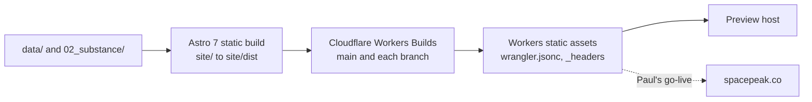

# Space Peak

| | |
| --- | --- |
| What | The spacepeak.co website, and the speculative thesis behind it |
| Preview | [spacepeak.coloradostartups.workers.dev](https://spacepeak.coloradostartups.workers.dev), built from `main` |
| Go-live on spacepeak.co | Paul gives it |
| Start | `docs/START-HERE.md`, then `CONTRIBUTING.md` |



### Where data lives

| Data | File | Read by |
| --- | --- | --- |
| Organisations | `data/orgs/`, one YAML file each | `site/src/content.config.ts` |
| Mountain claims | `02_substance/claims_register.md` | `site/src/lib/claims/parse.ts` |
| Map summits and roads | `03_deliverables/map/` | `04_tools/space_peak_map.py` |
| Brand art and tokens | `site/public/art/`, `site/src/styles/tokens.css` | `scripts/brand/pull.mjs` |

A concept for a ground-based electromagnetic mass driver bored through a Colorado peak, and the case for why cost-to-orbit is the choke point worth attacking.

**A speculative venture thesis, not an engineering proposal.** The physics is sound. The engineering is 2040s-hard. Every fact about a specific mountain in this repository is a starting point for real diligence, not a verified site assessment.

A [Colorado Startups](https://coloradostartups.org) project, supported by Colorado AI. Sibling projects: Photon Mountain, Fusion Canyon.

Brand: [Colorado Startups brand guide](https://colorado-startups.github.io/brand/)

## The map

[](https://colorado-startups.github.io/space-peak/map/)

The image shows the Colorado Startups region loop, which is the website's definition, not this project's launch complex (register R-01 to R-05). Click it for the live map, which adds the summits in the brief. The image is built and credited by coloradostartups.org, and this repository keeps no copy.

## Where the project stands

`00_project_system/MASTER_PLAN.md` gated everything behind one decision: park the idea, publish it, or develop it. That decision is made. **Publish**, under the Space Peak name, as a standalone piece rather than under the Photon Mountain umbrella.

Phase 3 of the master plan is active, and its venue is the spacepeak.co website (Decision 2026-11-16). Phases 2 and 4 are struck.

The repository is public so anyone can contribute. It is also the source of the spacepeak.co website. Paul gives the production go-live.

## Contributing

Anyone can contribute: corrections, sources, drafts, questions and tooling. Start with `docs/START-HERE.md`, then `CONTRIBUTING.md`. Questions and ideas go to [Discussions](https://github.com/Colorado-Startups/space-peak/discussions). Everyone here follows the [Code of Conduct](CODE_OF_CONDUCT.md).

## Folder map

```
00_project_system/   MASTER_PLAN.md. Read first.
01_doctrine/         voice.md. How this project writes, and what the linters enforce.
02_substance/        The concept brief, and claims_register.md.
03_deliverables/     The draft, the map (map/), the infographics.
04_tools/            The rules file, the four checkers and the map data builder.
site/                The Astro 7 website. wrangler.jsonc deploys site/dist.
data/                Site data: one YAML file per organisation in data/orgs/.
scripts/             The brand pull (scripts/brand/pull.mjs).
docs/                Contributor start-here.
local/               Operational files. Gitignored; the reviewer reads every path in the diff.
.claude/             Two skills, one agent, settings.
.github/             CI, templates, CODEOWNERS, ruleset definitions.
quality/             Git Crafter Quality and Process page configs.
```

## The two files to understand

### `02_substance/claims_register.md`

This project's real risk is not a leaked credential. It is a speculative mountain fact hardening into an asserted one somewhere between a draft and a published piece, with nobody able to point at the moment it happened. The register is every checkable claim with a status, machine-readable so a checker can act on it.

### `04_tools/space_peak_rules.json`

Every term, cue list, severity, limit and exemption, in one machine-readable file. Nothing in this repository hardcodes a rule that belongs there. `04_tools/space_peak_contract_test.py` asserts that every check is classified there and that the exempt list stays honest, so a new rule cannot be added without being registered.

## Enforcement: what a green check means

Two checks are required on `main`: `ci / ci-ok` and `DCO`. `ci / ci-ok` is the verdict of `.github/workflows/ci.yml`, which calls Git Crafter's `ci-standard.yml` and runs every Space Peak checker in one short job. A pull request cannot merge until both pass. The org ruleset "Protect default branches" also blocks deletion and force-push, and sends every change through a pull request.

Where the checks run:

| Control | Where | Blocking? |
| --- | --- | --- |
| Everything, on every pull request, forks included | `.github/workflows/ci.yml` | **Yes**, required on `main` |
| Secrets | GitHub secret scanning with push protection | **Yes**, at push |

CI covers every path a change can take: a laptop, the web UI, a fork or a cloud agent. There are no git hooks to turn on.

### What blocks and what warns

Severity comes from `04_tools/space_peak_rules.json`, following the rule *block on the certain, warn on the likely*. Blocking on a heuristic teaches people to bypass the gate, which costs more than it saves.

Blocking: the two dash checks. Everything else warns. The lists live in `severity` in the rules file, and nowhere else.

A checker that cannot run exits 3. In CI that fails the job, since a runner always has `python3`. Could not verify is not the same as verified and red.

### Where the required checks are defined

`.github/rulesets/protect-main.json` is the source of truth for the required checks. A change to that file takes effect only when a maintainer applies it with `gh api` to the live ruleset, so the two are checked against each other after every change.

## Running the checks yourself

Cloud first, the Mac last and small (Paul, 2026-11-02). Push your branch: `ci.yml` runs the self-tests, the contract test, the Quality collector test, and the claims and voice checkers over every tracked Markdown file (the `short:` block). When `site/` changes it also runs `astro check`, the build, vitest and the Playwright specs in Chromium (the `standard:` block). That job then prints the MCP conformance tally the Quality page reads.

One checker on the Mac is fine while you change it:

```bash
python3 04_tools/space_peak_lint.py --self-test
```

Every checker is standard library Python, deterministic, and offline. Each ships a self-test that seeds a known-bad and a known-clean sample. CI runs them before any real check, because a checker that has broken reports files clean, and that looks exactly like success.

## Quality and Process pages

`.github/workflows/pages.yml` builds Git Crafter's Quality, Speed and Consumption page and its Process page from `quality/config.json` and `quality/process/config.json`. They measure this repository's pull requests, CI and Claude sessions. Five metrics on the Pages tab are Space Peak's own: sourced orgs, figure status chips, orgs per kind, valid open data files and MCP conformance. `quality/collectors/space-peak.mjs` reads them against the goals in `quality/targets/space-peak.json`. They are not the thought-leadership piece, and publishing them publishes nothing about a mountain.

The same workflow serves the map in `03_deliverables/map/` at `/map/`. The map shows summits, so every claim on it carries its register status and every point its USGS GNIS source. It is a repository deliverable, not the piece.

## A template for sibling projects

This scaffolding is built to be copied into sibling projects such as Photon Mountain and Fusion Canyon. The parts worth copying are the rules-in-data pattern and the contract test. So is the one-definition-many-call-sites shape, which keeps the harness and CI from disagreeing.

## License

Everything Colorado Startups wrote here is dedicated to the public domain under [CC0 1.0](LICENSE). Use it for anything, with no credit needed. The code (`04_tools/`, `.github/workflows/`) is also offered under [0BSD](LICENSES/0BSD.txt), whichever you prefer.

Two things here belong to others and keep their own terms:

- `CODE_OF_CONDUCT.md` is adapted from the Contributor Covenant 3.0, licensed CC BY-SA 4.0.
- The basemap tiles in `03_deliverables/map/index.html` load at view time from OpenFreeMap (OpenMapTiles, OpenStreetMap contributors), and its terrain from Mapterhorn. The map displays their credit. Its stored data is CC0: USGS GNIS points and US Census road lines.
