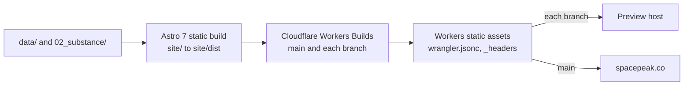

# Space Peak

| | |
| --- | --- |
| What | The spacepeak.co website, and the speculative thesis behind it. A concept for a ground-based electromagnetic mass driver bored through a Colorado peak, and the case for why cost-to-orbit is the choke point worth attacking |
| Site | [spacepeak.co](https://spacepeak.co), built from `main` |
| Live | Since 2026-11-28, on Paul's word |
| Where it stands | Next work: the [project board](https://github.com/orgs/Colorado-Startups/projects/11) ([docs/PROJECT.md](docs/PROJECT.md), with the map) |
| Start | [docs/START-HERE.md](docs/START-HERE.md), then [CONTRIBUTING.md](CONTRIBUTING.md) |
| Contribute | Open to anyone: corrections, sources, organisations, questions and tooling. Questions and ideas go to [Discussions](https://github.com/Colorado-Startups/space-peak/discussions). Everyone follows the [Code of Conduct](CODE_OF_CONDUCT.md) |
| Whose | A region, supported by [Colorado Startups](https://coloradostartups.org) and [Colorado Compute](https://coloradoai.us). Siblings: Photon Mountain, Fusion Canyon. [Brand guide](https://colorado-startups.github.io/brand/) |

**A speculative venture thesis, not an engineering proposal.** The physics is sound. The engineering is 2040s-hard. Every fact about a specific mountain in this repository is a starting point for real diligence, not a verified site assessment.

| Read next | For |
| --- | --- |
| [docs/DATA.md](docs/DATA.md) | Where data lives |
| [docs/CHECKS.md](docs/CHECKS.md) | What the checks do |
| [docs/RULES.md](docs/RULES.md) | The two files to understand |
| [docs/QUALITY.md](docs/QUALITY.md) | The Quality and Process pages |

## Folder map

| Folder | Holds |
| --- | --- |
| `00_project_system/` | MASTER_PLAN.md. Read first |
| `01_doctrine/` | voice.md and its parts. How this project writes, and what the linters enforce |
| `02_substance/` | The concept brief, and claims_register.md |
| `03_deliverables/` | The draft, the map (map/), the infographics |
| `04_tools/` | The rules file, four checkers, the map builder |
| `site/` | The Astro 7 website, `site/src/`; the /mcp Worker, `site/worker/` |
| `data/` | Site data: one YAML file per organisation (data/orgs/), and the startup credits |
| `scripts/` | The brand and startup credits pulls (scripts/brand/, scripts/resources/) |
| `docs/` | Contributor start-here, and the topic docs |
| `LICENSES/` | The CC0 and 0BSD license texts |
| `local/` | Operational files. Gitignored; the reviewer reads every path in the diff |
| `.claude/` | Two skills, one agent, settings |
| `.github/` | CI, templates, CODEOWNERS, rulesets |
| `quality/` | Git Crafter Quality and Process page configs, and our collector, `quality/collectors/` |

## License

| Part | By | Terms |
| --- | --- | --- |
| Everything Colorado Startups wrote here | Colorado Startups | Public domain under [CC0 1.0](LICENSE). Use it for anything, no credit needed |
| The code, `04_tools/` and `.github/workflows/` | Colorado Startups | Also [0BSD](LICENSES/0BSD.txt), whichever you prefer |
| The painting in `site/public/art/` | AI-made from a source photo by Huttarl, edited. See `site/public/art/NOTICE.md` | [CC BY 2.5](https://creativecommons.org/licenses/by/2.5/) |
| Display font, Aileron | [Dot Colon](https://www.dotcolon.net/fonts/aileron/) | [CC0 1.0](https://creativecommons.org/publicdomain/zero/1.0/) |
| Body font, Atkinson Hyperlegible | [Braille Institute](https://www.brailleinstitute.org/freefont/) | [SIL OFL 1.1](https://github.com/google/fonts/blob/main/ofl/atkinsonhyperlegible/OFL.txt) |
| `CODE_OF_CONDUCT.md` | Adapted from the [Contributor Covenant 3.0](https://www.contributor-covenant.org/version/3/0/) | [CC BY-SA 4.0](https://creativecommons.org/licenses/by-sa/4.0/) |
| The basemap tiles in `03_deliverables/map/index.html`, loaded at view time | [OpenFreeMap](https://openfreemap.org/) ([OpenMapTiles](https://openmaptiles.org/), [© OpenStreetMap contributors](https://www.openstreetmap.org/copyright)), and its terrain from [Mapterhorn](https://mapterhorn.com/attribution) | The map displays their credit |
| The map's stored data | USGS GNIS points and US Census road lines | CC0 |

Others' parts keep their own terms. Both fonts download at build time. The site's `/about/` page credits the same list, and `site/test/dom/about.test.ts` checks that the two match.
