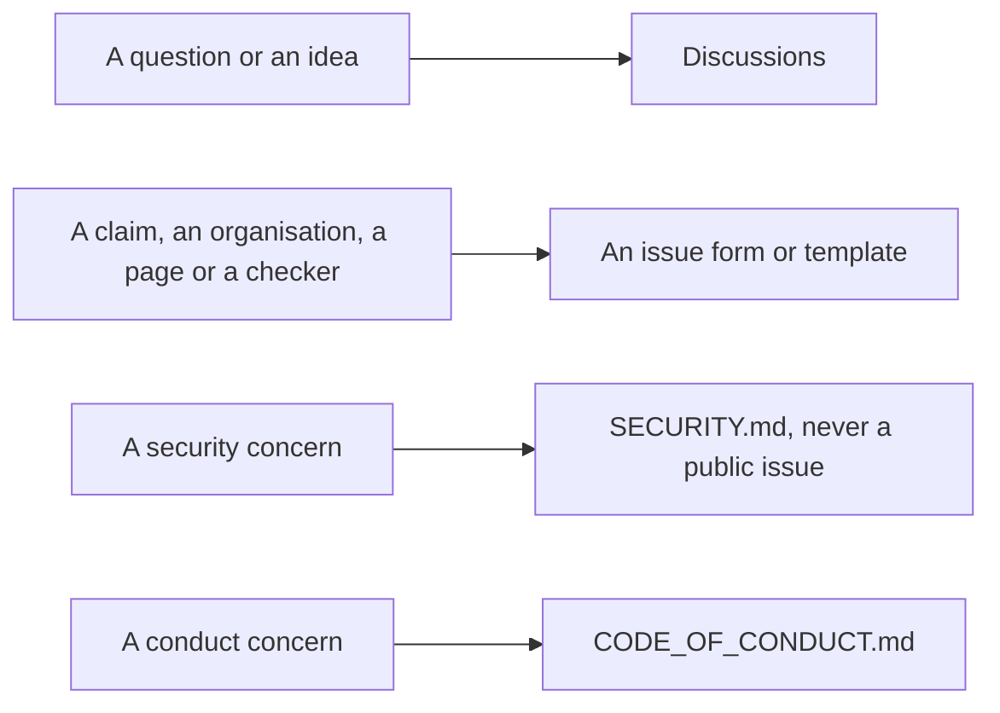

# Support

Space Peak is a speculative venture thesis and its website, spacepeak.co, not a product: there is nothing to install. Help here means help with the ideas, the evidence and the site.

| You have | Go to |
| --- | --- |
| A question | [Discussions](https://github.com/Colorado-Startups/space-peak/discussions), in Q&A |
| An idea | Discussions, in Ideas |
| A claim that is wrong or now verifiable | The **Claim correction** issue form. Bring the source |
| An organisation that belongs on the map | The **Add your organisation** issue form, with a public source |
| A page that is hard to see, hear, read or use | The **Accessibility problem** issue form |
| A page or an MCP tool that is broken | The **Site or MCP problem** issue template |
| A checker that misbehaved | The **Tooling** issue form |
| A security concern | `SECURITY.md`. Do not open a public issue |
| A conduct concern | `CODE_OF_CONDUCT.md` |

For a checker, false positives matter as much as false negatives: a guard that fires wrongly gets ignored, and an ignored guard looks like coverage while providing none.

For what the project is and where it stands, read `README.md`, then `docs/START-HERE.md`.
