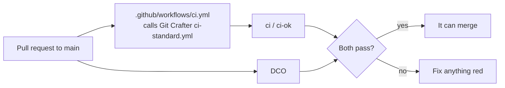

# What the checks do

Two checks are required on `main`: `ci / ci-ok` and `DCO`. A pull request cannot merge until both pass.

| Control | Where | Blocking? |
| --- | --- | --- |
| The checks a change's files need, on every pull request, forks included | `.github/workflows/ci.yml`, which calls Git Crafter's `ci-standard.yml`. One short job runs every Space Peak checker in `04_tools/`, and `ci / ci-ok` is its verdict | **Yes**, required on `main` |
| Secrets | GitHub secret scanning with push protection | **Yes**, at push |
| Deletion, force-push, and any change outside a pull request | The org ruleset "Protect default branches" | **Yes** |

CI covers every path a change can take: a laptop, the web UI, a fork or a cloud agent. There are no git hooks to turn on, and none to skip: every check runs in CI. The Claude Code harness is also denied `--no-verify` and force-push outright.

GitHub holds the first workflow run from a new contributor until a maintainer approves it. That is GitHub's protection for public repositories, not a judgement on your pull request.

## What blocks and what warns

Severity comes from `severity` in `04_tools/space_peak_rules.json`, and nowhere else. It follows the rule *block on the certain, warn on the likely*.

| Severity | What | Why |
| --- | --- | --- |
| Blocks | The two dash checks: an em dash or a spaced en dash, anywhere. Use a comma, semicolon, period, or parentheses | The rule is deterministic |
| Blocks, at push | A detected secret. GitHub's push protection rejects the push | |
| Warns | Everything else: a bare figure, an unregistered mountain claim, an unlabelled one, a long sentence, a hedge word | Each is a heuristic |

Read the warnings; they are usually right. They do not stop you, because a gate that fires wrongly and blocks gets bypassed. Blocking on a heuristic teaches people to bypass the gate, which costs more than it saves. A bypassed gate is worse than none.

A checker that cannot run exits 3. In CI that fails the job, since a runner always has `python3`. Could not verify is not the same as verified and red.

## Where the required checks are defined

`.github/rulesets/protect-main.json` is the source of truth for the required checks. A change to that file takes effect only when a maintainer applies it with `gh api` to the live ruleset. So the two are checked against each other after every change.

To run the checks yourself, read [RUNNING-CHECKS.md](RUNNING-CHECKS.md). To change a rule, read [RULES.md](RULES.md).
