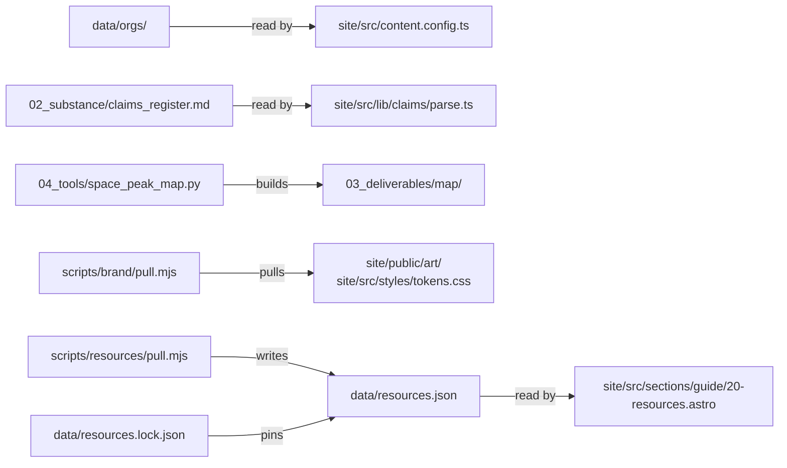

# Where data lives

| Data | File | Code |
| --- | --- | --- |
| Organisations | `data/orgs/`, one YAML file each | Read by `site/src/content.config.ts` |
| Mountain claims | `02_substance/claims_register.md` | Read by `site/src/lib/claims/parse.ts` |
| Map summits and roads | `03_deliverables/map/` | Built by `04_tools/space_peak_map.py` |
| Brand art and tokens | `site/public/art/`, `site/src/styles/tokens.css` | Pulled by `scripts/brand/pull.mjs` |
| Startup credits | `data/resources.json`, pinned by `data/resources.lock.json` | Read by `site/src/sections/guide/20-resources.astro`, written by `scripts/resources/pull.mjs` |

The [README](../README.md) draws how this data becomes the site.
