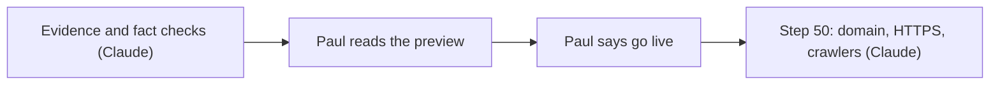

# Go-live

What spacepeak.co needs before it goes live, who does it, and the evidence. Step 49 wrote it ([#188](https://github.com/Colorado-Startups/space-peak/issues/188)). Step 50 waits on Paul's own "go live".

## The list

| Item | Owner | State | Evidence |
| --- | --- | --- | --- |
| Five odds approved | Paul | Done | [#176](https://github.com/Colorado-Startups/space-peak/pull/176), [#180](https://github.com/Colorado-Startups/space-peak/pull/180) |
| Evidence on the preview | Claude | Done | [Evidence](#evidence) |
| Publish gate, fact-reviewer pass | Claude | Done | [Fact checks](#fact-checks) |
| Open data leaves out the Blanca and Crestones rows | Claude | Done | [#199](https://github.com/Colorado-Startups/space-peak/issues/199), [#204](https://github.com/Colorado-Startups/space-peak/pull/204) |
| The world's launch count on `/launch/` brought up to date | Claude | Done | [#198](https://github.com/Colorado-Startups/space-peak/issues/198), [#203](https://github.com/Colorado-Startups/space-peak/pull/203) |
| `/map/`'s drawings open on what they show at 375 px | Claude | Done | [#194](https://github.com/Colorado-Startups/space-peak/issues/194), [#209](https://github.com/Colorado-Startups/space-peak/pull/209) |
| Read the preview | Paul | Waiting | [spacepeak.coloradostartups.workers.dev](https://spacepeak.coloradostartups.workers.dev/) |
| Say "go live" | Paul | Waiting | Paul's words in chat |
| Claude review token, a sign-in | Paul | Open, not needed to go live | Without it, `security.claude_review_share` reads 0% on 2026-11-28, a miss, per the [Quality page](https://colorado-startups.github.io/space-peak/) |
| Admin-read token, a sign-in | Paul | Open, not needed to go live | 23 metrics stay unmeasured and unscored, per the Quality page |
| spacepeak.co on the Worker, the www redirect, HTTPS | Claude | Step 50, after Paul's yes | No routes in `wrangler.jsonc`; spacepeak.co has no address record (dig, 2026-11-28) |
| AI crawlers allowed | Claude | Step 50 checks the zone | The preview's robots.txt allows all agents, AI input and AI training |

## Evidence

| Evidence | Result | Source |
| --- | --- | --- |
| `ci.yml` on main at 0147c8f, merged here | 52 Playwright tests pass, axe on every route at 375 px and 1280 px | [run 46166041436](https://github.com/Colorado-Startups/space-peak/actions/runs/46166041436) |
| Lab vitals, worst of `/` and `/404.html` | LCP 0.79 s, CLS 0, TBT 0 ms, per the Quality page at 0147c8f, 2026-11-28 | [Design and Usability tabs](https://colorado-startups.github.io/space-peak/) |
| Quality page | Master 87 at 0147c8f, per the page, 2026-11-28 | [colorado-startups.github.io/space-peak](https://colorado-startups.github.io/space-peak/) |

Each page loaded in a browser at 375 px and 1280 px. On each: status 200, one h1, no sideways page scroll, every image loaded and sized, no Blanca or Crestones text. Screenshots were read, not committed. The pane ran hidden: its timings are not lab numbers.

| Page | Also checked | Found |
| --- | --- | --- |
| `/` | Masthead, painting, odds | The lead line read as fact; it now says it is our thesis |
| `/map/` | Region drawing | At 375 px it opened on its empty west edge: [#194](https://github.com/Colorado-Startups/space-peak/issues/194). [#209](https://github.com/Colorado-Startups/space-peak/pull/209) opens it on the loop |
| `/guide/` | Filter, search, both tables | The filter script moved the table after first paint. Fixed in this step |
| `/launch/` | Profile, cadence, sites | Fine: the cadence slider loads below the fold |
| `/ai/` | Copy buttons, setup steps | Nothing |
| `/about/` | Listing flow, credits table | Its credits table scrolls in its own box |

## Fact checks

| Check | Result |
| --- | --- |
| Sources in `data/estimates/q-03.yaml` and `q-04.yaml` | Each cited line confirmed in a browser. q-03 adds the two 2008 Federal Register notices it cites |
| Publish gate over the six built pages | Self-tests pass; lint and claims find nothing blocking |
| Fact-reviewer | Six findings: three fixed here (q-03's sources, the home lead, the licence line), three filed ([#198](https://github.com/Colorado-Startups/space-peak/issues/198), [#199](https://github.com/Colorado-Startups/space-peak/issues/199), [#200](https://github.com/Colorado-Startups/space-peak/issues/200)). Two side notes: #200 and [#201](https://github.com/Colorado-Startups/space-peak/issues/201) |
