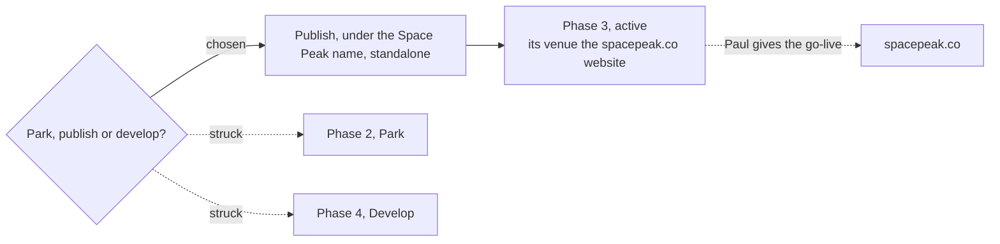

# Where the project stands

`00_project_system/MASTER_PLAN.md` gated everything behind one decision: park the idea, publish it, or develop it. That decision is made.

| Item | Where it stands |
| --- | --- |
| The decision | **Publish**, under the Space Peak name, as a standalone piece, not under the Photon Mountain umbrella |
| Phase 3 of the master plan | Active. Its venue is the spacepeak.co website (Decision 2026-11-16) |
| Phases 2 and 4 | Struck |
| The repository | Public, so anyone can contribute. It is also the source of the spacepeak.co website |
| The production go-live | Paul gives it |

## The map

The image shows the Colorado Startups region loop, which is the website's definition, not this project's launch complex (register R-01 to R-05). Click it for the live map, which adds the summits in the brief. The image is built and credited by coloradostartups.org, and this repository keeps no copy.
