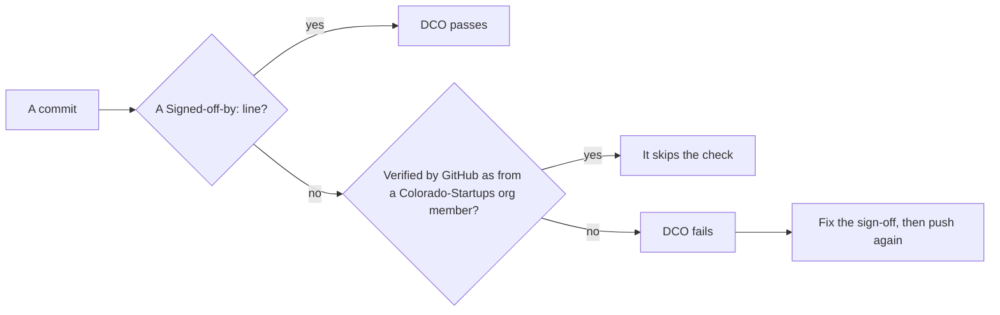

# Pull requests: sign-off, licensing and review

The detail behind [CONTRIBUTING.md](../CONTRIBUTING.md#making-a-pull-request).

## Sign-off (DCO)

Every commit needs a `Signed-off-by:` line, which `git commit -s` adds. It certifies the [Developer Certificate of Origin](https://developercertificate.org/): you wrote the change, or you have the right to submit it. The `DCO` check fails without it.

| Missed sign-off on | Fix it with |
| --- | --- |
| One commit | `git commit --amend -s`, then push again |
| Several commits | `git rebase --signoff main`, then push again |

Commits that GitHub verifies as coming from `Colorado-Startups` org members skip the check (`.github/dco.yml`).

## Licensing of your contribution

Space Peak is dedicated to the public domain under CC0 1.0, and its code is also offered under 0BSD. See the [README's License section](../README.md#license). Your contribution comes in under the same terms. Do not submit material you cannot release that way, such as someone else's copyrighted text, images or data.

## Help from an AI agent

Using an AI agent is fine. Say so in the pull request. Agents follow `CLAUDE.md`; see `AGENTS.md`.

## For maintainers: reviewing outside pull requests

| Step | Rule |
| --- | --- |
| Read | Read the diff on GitHub or with `gh pr diff <number>`. Never check out or run a fork's code on your own machine. CI runs it in the cloud with a read-only token and no secrets |
| Approve the first run | Only after reading what the pull request changes under `.github/`, `.claude/`, `quality/` and `04_tools/` |
| Merge | Squash merge, so `main` keeps one signed-off commit per pull request |
