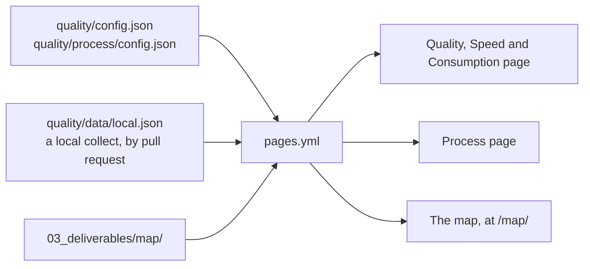

# Quality and Process pages

`.github/workflows/pages.yml` builds Git Crafter's Quality, Speed and Consumption page and its Process page, from `quality/config.json` and `quality/process/config.json`. They measure this repository's pull requests, CI and Claude sessions. They are not the thought-leadership piece, and publishing them publishes nothing about a mountain.

## Space Peak's own metrics

Five metrics on the Pages tab are Space Peak's own. `quality/collectors/space-peak.mjs` reads them against the goals in `quality/targets/space-peak.json`.

- Sourced orgs
- Figures shown with their status
- Orgs per kind
- Valid open data files
- MCP conformance checks passed

The MCP share comes from a notice that `ci.yml`'s standard job leaves on itself after the Playwright specs, read back through GitHub's Checks API.

## Metrics from this Mac

Some metrics need this Mac's own data: deploys through Wrangler, the Claude tabs from Claude Code transcripts, and credits. CI cannot read them. So a session runs Git Crafter's local collect and commits `quality/data/local.json` by pull request ([Git Crafter's Quality README](https://github.com/SoulCraft-Org/git-crafter/blob/8023bd4683416f6d420bd20d137960b09c06b91e/quality/README.md)).

| Step | What happens |
| --- | --- |
| Checkout | A Git Crafter checkout at the pin, with the two packs in `CODE_OS_PACKS` |
| Collect | `collect.mjs --local --only NAME`, once per collector, because a full run would also run vitest and a browser, which stay in CI |
| Scrub | Before the commit, `node quality/local-check.mjs --scrub` rewrites the local paths collectors leave |
| Test | `quality/local-check.test.mjs` then fails on transcript text, home paths, emails, account names or keys |
| Keep local | The run's `quality/history/` file and the `quality/data/plan-usage.json` it reads stay on the machine |
| Check the page | `pages.yml` checks that the built page shows each measured local metric |

## The map at /map/

The same workflow serves the map in `03_deliverables/map/` at `/map/`. It is a repository deliverable, not the piece.

| Where | Rule |
| --- | --- |
| The map page | It says "speculative" once, and every summit point keeps its USGS GNIS source |
| Across the site | A sourced figure shows a small "source" link. A page with an unconfirmed figure says so in one line (`01_doctrine/voice-map-and-site.md`, Figures on the site) |
