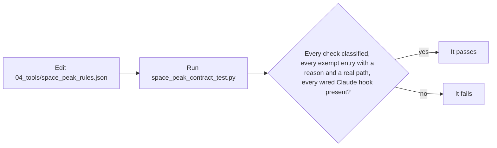

# The rules and the register

The two files to understand:

| File | What it holds | Why it matters |
| --- | --- | --- |
| `02_substance/claims_register.md` | Every checkable claim with a status, machine-readable so a checker can act on it | This project's real risk is not a leaked credential. It is a speculative mountain fact hardening into an asserted one somewhere between a draft and a published piece, with nobody able to point at the moment it happened |
| `04_tools/space_peak_rules.json` | Every term, cue list, severity, limit and exemption, in one machine-readable file | Nothing in this repository hardcodes a rule that belongs there |

## Changing a rule

Rules live in `04_tools/space_peak_rules.json`, never in a script or a workflow. Edit the data file, then run:

```bash
python3 04_tools/space_peak_contract_test.py
```



The contract test asserts that every check is classified in the rules file and that the exempt list stays honest. So a new rule cannot be added without being registered. It fails if a new check is unclassified, or if an exempt entry has no reason or no longer matches a real path. It also fails if a Claude hook is wired but missing.

## If a check is wrong

Open a **Tooling** issue with the exact input. False positives are worth reporting as urgently as false negatives.

Do not work around a check by rewording a claim into something the regex misses. That is the one failure mode none of this can catch.

## Two things no check can catch

Verify these by hand before anything ships:

| Drift | Example |
| --- | --- |
| A hedged source set as an exact number in display type | "About 200 g" becoming "200 g" in a pull quote |
| A status verb drifting under compression | "The brief proposes" becoming "the plan is" |

## A template for sibling projects

This scaffolding is built to be copied into sibling projects such as Photon Mountain and Fusion Canyon. The parts worth copying are the rules-in-data pattern and the contract test. So is the one-definition-many-call-sites shape, which keeps the harness and CI from disagreeing.
