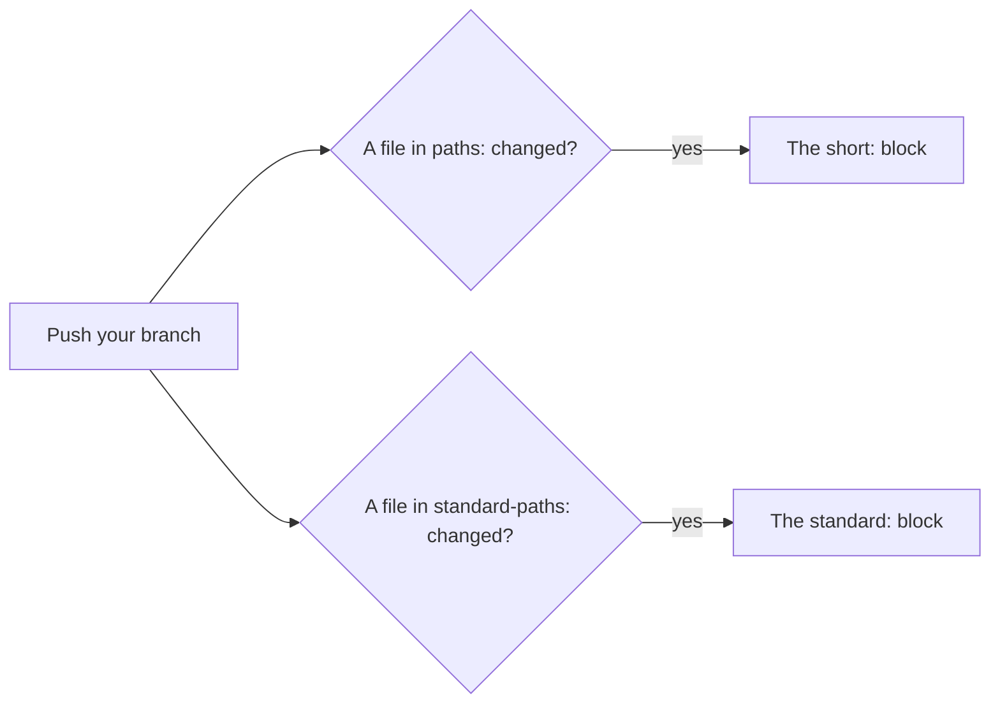

# Running the checks yourself

Cloud first, the Mac last and small (Paul, 2026-11-02). Push your branch, and `.github/workflows/ci.yml` runs the blocks your change needs.



| Block in `ci.yml` | Runs when | Runs |
| --- | --- | --- |
| `short:` | A file it reads changes (its `paths:` list) | The self-tests, the contract test, the Quality collector test and the local run check. Also the claims and voice checkers, over every tracked Markdown file |
| `standard:` | A change to `site/`, `data/`, `package.json`, the lockfile, `.nvmrc` or `wrangler.jsonc` | `astro check`, the build, vitest, the Playwright specs in Chromium and the MCP conformance suite |

## One checker on the Mac

One checker on the Mac is fine while you change it. Run one locally if you want an earlier answer; the commands are the `short:` block in `ci.yml`.

```bash
python3 04_tools/space_peak_lint.py --self-test
```

| Every checker | Is |
| --- | --- |
| Written in | Standard library Python, deterministic, and offline |
| Tested by | Its own self-test, which seeds a known-bad and a known-clean sample |
| Run in CI | Self-test first, before any real check, because a checker that has broken reports files clean. That looks exactly like success |

[CHECKS.md](CHECKS.md) says what blocks and what warns.
